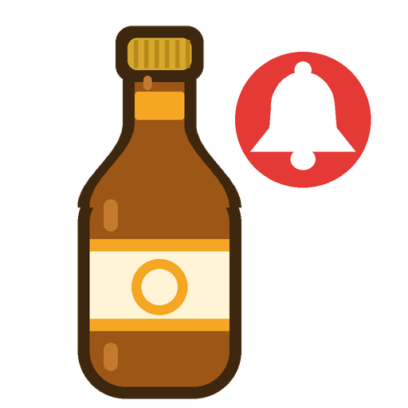

# BierAlarm

Home-Assistant-Integration, die **Bieraktionen** in den Flugblättern österreichischer Supermärkte findet. Sie zeigt sie in einer eigenen Seite in der Seitenleiste an und schlägt Alarm, wenn deine Lieblingsmarke in Aktion ist oder der Literpreis unter dein Limit fällt.

## Was es kann

| Markt | Quelle | KI nötig? |
|---|---|---|
| PENNY | Bier-Kategorie auf penny.at (strukturierte Daten) | Nein |
| Lidl | Bieraktion-Kategorie auf lidl.at, je Region (Ost/West/Süd) | Nein |
| MPREIS | Seite „Bier in Aktion“ auf mpreis.at | Nein |
| BILLA / BILLA PLUS | PDF-Flugblatt von billa.at | Ja |
| Eigene Flugblätter | Beliebige PDF-Links | Ja |

- **Preis pro 20er-Kiste**: Jede Aktion wird auf 20 × 0,5 l (10 Liter) umgerechnet, damit Dosen, Träger und Kisten vergleichbar sind (ohne Pfand)
- **Seitenleiste „BierAlarm“**: alle Aktionen als Karten, sortierbar nach Kistenpreis, Preis, Rabatt oder Ablauf, mit Filter nach Markt und Suche
- **Sensoren**: `sensor.bieralarm_bieraktionen` (Anzahl plus Liste), `sensor.bieralarm_bester_preis_pro_20er_kiste` und `sensor.bieralarm_bester_literpreis`
- **Umkreis** (`number.bieralarm_radius`, auch in der Karte mit − / + änderbar): nur Märkte mit einer Filiale im Umkreis (z. B. 7 km) um den Standort aus den Home-Assistant-Einstellungen. Die Filialen kommen einmal pro Woche von OpenStreetMap; dabei wird nur ein grob gerundeter Bereich abgefragt.
- **Preis-Alarm** (`number.bieralarm_alarm_below_crate_price`): Glocke und Benachrichtigung, wenn eine 20er-Kiste höchstens so viel kostet. 0 = nur die gewählten Sorten.
- **Sorten-Schalter**: `switch.bieralarm_alarm_zipfer_urtyp`, `switch.bieralarm_alarm_zipfer_marzen` usw., ein Schalter pro Biersorte: an = benachrichtigen. Jeder Schalter zeigt das Produktfoto der letzten Aktion dieser Sorte. Sie sind mit *Lieblingsmarken* in den Einstellungen verbunden. Dort trägst du auch eigene Sorten ein; nur die Marke (z. B. `Zipfer`) heißt alle Sorten.
- **Alkoholgehalt** in % vol bei jeder Aktion: aus den Angaben des Markts, sonst ein typischer Wert der Sorte (in der Karte mit „ca.“ markiert)
- **Filter für Dashboards**: `text.bieralarm_filter` (Suchtext, z. B. `Urtyp`) und `select.bieralarm_store_filter` (Markt)
- **Alarm**: Benachrichtigung über eine `notify`-Entität (z. B. dein Handy) oder als Home-Assistant-Meldung. Jede Aktion wird nur einmal gemeldet.
- **Event** `bieralarm_new_deal` für eigene Automationen
- **Aktion** `bieralarm.refresh`, optional mit `reanalyse: true`, damit die KI die PDFs neu liest

### So werden PDF-Flugblätter gelesen

1. BierAlarm lädt das PDF und zieht den Text heraus, ganz ohne KI.
2. Nur die Seiten, auf denen Bier vorkommt, gehen an deine **KI-Aufgabe** (`ai_task`, z. B. Anthropic, OpenAI, Google Gemini oder Ollama).
3. Das Ergebnis wird pro Flugblatt gespeichert, also gibt es **einen KI-Aufruf pro Flugblatt und Woche**.

## Installation

### Über HACS / Marketplace (benutzerdefiniertes Repository)

1. HACS → ⋮ → *Benutzerdefinierte Repositories* → `https://github.com/Urtyp50/BierAlarm`, Typ **Integration**
2. *BierAlarm* installieren und Home Assistant neu starten
3. *Einstellungen → Geräte & Dienste → Integration hinzufügen → BierAlarm*

### Manuell

Den Ordner `custom_components/bieralarm` nach `config/custom_components/` kopieren und Home Assistant neu starten.

## Dashboard-Karte

Die Karte `custom:bieralarm-card` kommt mit der Integration mit, es muss keine Ressource eingetragen werden. Sie findet ihre Entitäten selbst:

```yaml
type: custom:bieralarm-card
```

Sie zeigt den besten Kistenpreis, eine kleine Karte mit den Filialen im Umkreis und der Adresse des Startpunkts, Suche und Markt-Filter, alle Aktionen mit Preis pro 20er-Kiste und Entfernung sowie die Sorten-Schalter, gruppiert nach Marke.

## Einstellungen

| Option | Bedeutung |
|---|---|
| Märkte | Welche Märkte durchsucht werden |
| Lidl-Region | Ost (Wien/NÖ/Bgld), West (OÖ/Sbg/T/Vbg) oder Süd (Stmk/Ktn) |
| BILLA-Region | Bevorzugtes Regional-Flugblatt |
| KI-Aufgabe | Für BILLA und eigene PDFs nötig |
| Umkreis | z. B. `7` km um dein Zuhause, `0` = alle Märkte |
| Lieblingsmarken | z. B. `Gösser, Stiegl, Ottakringer` |
| Alarm unter Literpreis | z. B. `1,50` €/l |
| Benachrichtigung an | `notify`-Entität, leer = Home-Assistant-Meldung |
| Weitere PDF-Flugblatt-Links | Ein Link pro Zeile |

Ein Alarm kommt, wenn eine **Lieblingsmarke** in Aktion ist **oder** ein Bier **unter dem Literpreis** liegt.

## Beispiel-Automation

```yaml
triggers:
  - trigger: event
    event_type: bieralarm_new_deal
actions:
  - action: notify.mobile_app_handy
    data:
      title: "🍺 {{ trigger.event.data.title }}"
      message: >
        {{ trigger.event.data.store }}: € {{ trigger.event.data.price }}
        ({{ trigger.event.data.price_per_liter }} €/l) bis {{ trigger.event.data.valid_to }}
```

## Grenzen

- **SPAR und HOFER** sperren automatische Abrufe, deshalb sind sie nicht dabei. Wenn du ein PDF-Flugblatt davon als Link hast, kannst du es unter *Weitere PDF-Flugblatt-Links* eintragen.
- Die Seiten werden alle 6 Stunden abgefragt. Ändert ein Markt seine Webseite, kann ein Leser ausfallen. Die anderen laufen weiter, und der Fehler steht in der Seitenleiste.
- Preise sind ohne Gewähr und teils exklusive Pfand. KI-gelesene Angebote sind mit **KI** markiert und sollten im Flugblatt gegengeprüft werden.
- Inoffiziell, keine Verbindung zu PENNY, Lidl oder BILLA.

## Entwicklung

Nur die Leser (schnell, ohne Home Assistant):

```bash
pip install pytest pypdf
pytest tests/test_parsers.py
```

Alles, inklusive Test in einem echten Home-Assistant-Kern:

```bash
pip install pytest-homeassistant-custom-component pypdf home-assistant-frontend
pytest
```

Die Testdaten in `tests/fixtures` sind auf die reinen Angebotsdaten gekürzte Seiten aus KW 47/2026.
